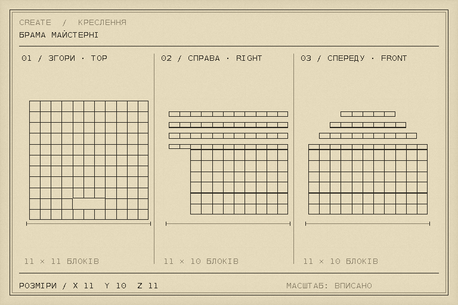

# Create: Drafting Posters — 1.0.0

[Завантажити повний пакет ZIP](https://github.com/2sparta/Empirecraft/raw/refs/heads/main/create-posters/dist/Create-Drafting-Posters-1.0.0.zip) · [Завантажити JAR](https://github.com/2sparta/Empirecraft/raw/refs/heads/main/create-posters/dist/create-drafting-posters-1.20.1-1.0.0.jar) · [Вихідний код ZIP](https://github.com/2sparta/Empirecraft/raw/refs/heads/main/create-posters/dist/create-drafting-posters-1.0.0-sources.zip)



Перша тестова збірка доповнення для Minecraft 1.20.1 / Forge. Зібрана проти наданого `create-1.20.1-6.0.8-medieval.4.jar` і бібліотек Forge 47.4.23. Java 17 або новіша.

## Що додано

На звичайному столі для креслень Create з’являється кнопка **Плакат**. Вона відкриває сторінку цього ж столу з вибором ракурсів і попереднім переглядом. Новий блок столу не додається.

Можна обрати від одного до шести ракурсів: згори, справа, спереду, зліва, ззаду, знизу. Типово обрано згори, справа й спереду. Усі вибрані види потрапляють на один плакат: чорні лінії, вицвілий папір, тонка рамка, назва файлу схеми та розміри. Плакат займає **3×2 блоки** на стіні.

## Встановлення

Покладіть `create-drafting-posters-1.20.1-1.0.0.jar` у `mods` клієнта і сервера. В одиночній грі достатньо клієнта. Потрібен наданий Create та його звичайні залежності. Цей JAR є окремим доповненням: наявний Create залиште встановленим.

## Як зробити плакат

1. Збережіть будівлю пером і кресленням Create.
2. На столі для креслень звичайним способом запишіть цю схему на порожнє креслення й дочекайтеся завершення завантаження.
3. Залиште записане креслення у вихідному слоті. Також можна взяти його в одну з рук і знову відкрити стіл. Якщо у вихідному слоті лежить інше записане креслення, пріоритет має вихідний слот.
4. Натисніть **Плакат**, оберіть ракурси й натисніть **Переглянути**. Після зміни ракурсів оновіть перегляд.
5. Майте **4 папери й 1 звичайний чорнильний мішок** в основному інвентарі та один вільний слот. Натисніть **Створити плакат**. У творчому режимі матеріали не витрачаються.
6. Натисніть ПКМ плакатом по стіні. Потрібна вільна суцільна ділянка 3×2 блоки. Знімається ударом, як картина; у режимі виживання випадає той самий плакат із зображенням.

Креслення не витрачається. Матеріали й доступ до столу перевіряє сервер. Готові зображення містяться у даних предмета/сутності, тому після створення плакат не залежить від подальшої наявності початкового `.nbt`-файлу. Назва береться з назви файла схеми; текст на самому аркуші українською з англійськими позначеннями ракурсів.

## Межі першої версії

- До 256 блоків на кожну вісь та 65 536 записів блоків у NBT схеми, включно із записаним повітрям. Для більших споруд збережіть меншу ділянку.
- Відтворюється статична геометрія блоків за їхніми VoxelShape. Сходи, плити та інші форми враховуються; складні декоративні моделі можуть спрощуватись. Текстури, рідини, моби, предмети й анімація механізмів не друкуються. Блоки з відсутніх модів неможливо відтворити.
- У різних комірках ракурси вписуються у доступне місце; це не спільний числовий масштаб для всього аркуша.
- На клієнті кешуються до 32 текстур плакатів, на сервері — до 8 наборів проєкцій.
- Відсутній рецепт у верстаку: отримання відбувається на столі Create.

## Перевірки та статус

Пройшли компіляція в байткод Java 17 і 30 перевірок: видимі контури, прихована геометрія, осі ракурсів, плити, макети для 1–6 видів, коректність NBT, незмінність зображення після NBT-передавання, відхилення некоректних даних та кодування мережевих пакетів. Перевірено 563 посилання байткоду на доступні класи Minecraft, Forge та Create. У JAR немає класів Minecraft або compile-only заглушок.

**Повний запуск Forge-сервера й графічного Minecraft-клієнта не виконано.** Частина клієнтських API компілюється проти compile-only декларацій, оскільки повного клієнта в середовищі немає. Цю збірку слід спочатку перевірити у тестовому світі: відкрити стіл, створити плакат, поставити його на стіни різних напрямків, зняти та перезайти у світ. Знімок `poster-preview.png` отримано справжнім компонувальником цього мода з тестової блокової моделі; це приклад зображення, а не скриншот із гри.

## Вихідний код і повторне збирання

Архів вихідного коду містить `src`, `build.py`, перевірки, compile-only декларації клієнтських API та ліцензії. Minecraft/Create у нього не включені. Потрібен локальний встановлений SRG runtime Forge 1.20.1/47.4.23 з бібліотеками та наданий JAR Create, SHA-256 якого зафіксовано у `dependencies.json`.

```sh
python3 build.py --runtime /path/to/forge-server --create /path/to/create-1.20.1-6.0.8-medieval.4.jar --test
```

Скрипт не завантажує залежності з мережі й не змінює інсталяцію гри; створює JAR у `dist`. Основні Minecraft API у джерелах мають стабільні SRG-назви. Алгоритми проєкції та макетування — звичайний Java-код у `Projection.java` і `Paper.java`.

Код — MIT. Вбудований растровий піднабір DejaVu — за ліцензією DejaVu, текст у `META-INF/DejaVu-LICENSE.txt`. Create залишається окремою залежністю зі своєю ліцензією.
