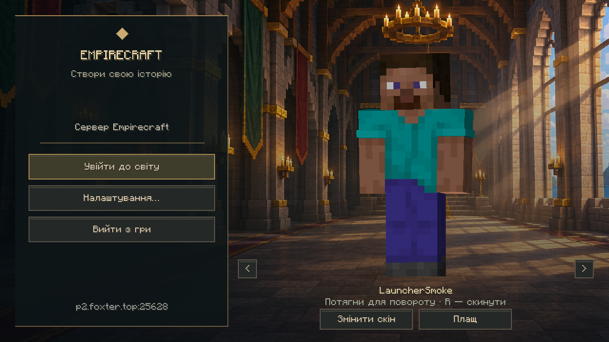

# In-game menu verification

Screenshots in this directory are captured from the real Minecraft 1.20.1 / Forge 47.4.23 client, not browser mockups. The fixture installs the signed public Potato pack, replaces only the launcher client addon with 0.2.0, then opens the menu without joining a server.

The fixture exercises skin/cape editors, return to home, settings, model rotation/reset, and window resizing. Separate Java geometry checks cover eight GUI sizes, including 320×240 and ultrawide. This verifies the menu and its dependency integration, not current server login, gameplay, shaderpacks, real Windows GPU drivers or laptop FPS.

Verified final JAR: `1ec494b5a81cfc66e59a50bfab4c12c13f36cc317d569e85a89497d01d64a4ed`. [Successful graphical workflow](https://github.com/2sparta/EmpireCraftLauncher/actions/runs/43819965336), head `155a5af05cc2f4246893e4d8700184ea42d4076c`. Both `FULL_PACK_MAIN_MENU_PASS` and `REAL_MENU_FLOW_PASS` markers are present. The artifact and local native build have the same SHA-256. `runtime.json` records the baseline, screenshots and remaining acceptance checks.

