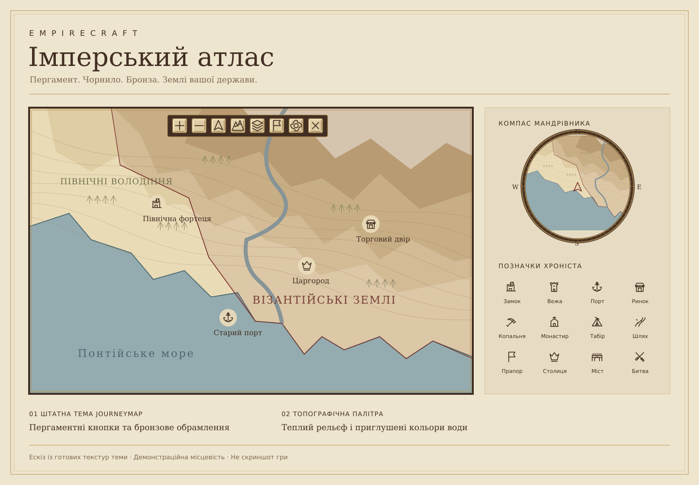

# EmpireCraft — Імперський атлас

Середньовічне оформлення для **JourneyMap Forge 1.20.1 / 6.0.7**: пергаментні кнопки, темні бронзові панелі, кругла рамка компаса, чорнильні піктограми, тепла топографічна палітра та 12 позначок замків, веж, портів, ринків, копалень, монастирів, таборів, шляхів, прапорів, столиць, мостів і битв.



Ескіз показує палітру та готові текстури на демонстраційній місцевості. У грі зберігається стандартний шрифт Minecraft.

Це штатна тема JourneyMap 6 (`schema: 2`) та ресурс-пак. JAR JourneyMap і моста, моди клієнта та відбитки ADM не змінюються. Кордони, назви держав і Shift+клік по території продовжує надавати наявний міст Towny. Кольори держав залишаються їхніми кольорами з Towny; серверний пресет лише зменшує щільність заливки й товщину кордонів.

## Встановлення гравцю

1. Завантажити **EmpireCraft-Medieval-Atlas-1.0.1.zip** і розпакувати в окрему папку.
2. Закрити Minecraft. Запустити **Install-Windows.cmd** та вставити шлях до папки саме клієнтської збірки, де знаходиться `mods/`. У лаунчері це можна зробити через «Відкрити папку збірки». Це може бути не стандартна `%APPDATA%\.minecraft`.
3. Запустити гру та натиснути **J**. Тема **EmpireCraft Atlas** вже обрана, набір позначок **«Імперський атлас»** увімкнений. У редакторі точки натиснути її піктограму та вибрати потрібний символ.

Інсталятор змінює лише поля оформлення JourneyMap, активує власний ресурс-пак і зберігає резервну копію файлів, які змінює. Власні розміри шрифтів, клавіші, параметри радара та інші ресурс-паки зберігаються. Дані дослідженої мапи й точки маршруту не змінюються. Якщо світ/сервер має окремі налаштування, ті самі поля оформлення оновлюються і в його `config/`.

Тепла палітра працює в режимі **Topographic / Топографічна мапа**. Це кольори рельєфу, а не фільтр усіх поверхневих текстур. Звичайний денний режим залишається доступним через кнопку типу мапи; тема рамок працює в обох режимах. Недосліджені місця залишаються недослідженими.

## Вручну або на іншій ОС

### Помилка «powershell.exe не є внутрішньою або зовнішньою командою»

У пакеті **1.0.1** виправлено Windows-запускач: він шукає PowerShell за повним системним шляхом, підтримує `Sysnative` для 32-бітного лаунчера, стандартні папки PowerShell 7 і лише потім перевіряє `PATH`. Змінювати системну змінну `PATH` для встановлення теми не потрібно.

Якщо пакет 1.0.0 вже розпаковано, достатньо замінити в ньому `Install-Windows.cmd` новим файлом. Якщо жодного PowerShell у Windows немає, запускач покаже зрозумілу помилку й посилання на офіційний PowerShell 7. Можна також скористатися ручним встановленням нижче.

У старому пакеті можна відкрити CMD в папці архіву й виконати команду з повним шляхом:

```bat
"%SystemRoot%\System32\WindowsPowerShell\v1.0\powershell.exe" -NoProfile -ExecutionPolicy Bypass -File "Apply-Atlas.ps1" -MinecraftDirectory "D:\Minecraft\game"
```

Системні шляхи: [документація Microsoft](https://learn.microsoft.com/en-us/powershell/module/microsoft.powershell.core/about/about_run_with_powershell).

### Ручне встановлення

Скопіювати вміст `payload/` у папку клієнтської збірки. У грі вибрати ресурс-пак **EmpireCraft Medieval Icons**, на мапі — тему **EmpireCraft Atlas** через кнопку палітри. Для теплих кольорів рельєфу перенести значення з `settings.json` у `journeymap/config/6.0/journeymap.topo.config` і вибрати топографічний режим. Наявні JSON-файли слід об'єднувати, зберігаючи інші поля.

Інсталятор також працює в PowerShell 7 на Linux/macOS:

```powershell
pwsh -File ./Apply-Atlas.ps1 -MinecraftDirectory '/path/to/instance'
```

## Повернути попередній вигляд

Після встановлення інсталятор друкує шлях `Backup:`. Закрити Minecraft і виконати, підставивши цей шлях:

```powershell
./Apply-Atlas.ps1 -MinecraftDirectory 'D:\Games\EmpireCraft' -Restore -BackupDirectory 'D:\Games\EmpireCraft\journeymap\empirecraft-atlas-backups\...'
```

Відновлюються файли в стані перед встановленням, включно з попереднім набором ресурс-паків. Нові файли теми видаляються. Це також поверне змінені пізніше параметри цих конфігурацій до стану резервної копії.

## Серверний пресет

У репозиторії `server/config/empirecraft_townymap-common.toml` отримує `fillOpacity = 0.12` і `borderWidth = 1.5`. Перенести ці два значення на робочий сервер і перезапустити його. Інші параметри синхронізації, назви територій і самі привати не змінюються. Клієнтську тему кожен гравець встановлює окремо; серверний пресет не може автоматично змінити інтерфейс JourneyMap на чужому клієнті.

## Збірка

Потрібні Python 3 та Inkscape. Усі піктограми й рамки — оригінальні векторні малюнки в `build.py`, без копіювання текстур JourneyMap.

```sh
python medieval-atlas/build.py
python medieval-atlas/preview.py
python medieval-atlas/build.py
```

Результат: `dist/EmpireCraft-Medieval-Atlas-1.0.1.zip`. PNG створюються із SVG, ресурс-пак має `pack_format: 15` для Minecraft 1.20.1, ZIP має стабільний порядок файлів і часові мітки. Відбиток — у сусідньому `.sha256`.

Перевірка інсталятора (потрібні PowerShell 7 і Pillow):

```sh
python medieval-atlas/tests/test_package.py --pwsh /path/to/pwsh --journeymap-jar mods/journeymap-forge-1.20.1-6.0.7.jar
```

`tests/NativeThemeTest.java` читає визначення через справжній клас `Theme` із JAR JourneyMap: перевіряє всі поля, кольори та прозорість масок. Для компіляції й запуску потрібні JDK 17, JAR JourneyMap, Gson та Guava. Результати — у `validation/medieval-atlas.md` репозиторію.

Офіційні формати: [теми JourneyMap 6](https://teamjm.github.io/journeymap-docs/6.0.x/tools/ui-themes/), [топографічні кольори](https://teamjm.github.io/journeymap-docs/6.0.x/tools/topographic/), [піктограми точок](https://teamjm.github.io/journeymap-docs/6.0.x/tools/waypoint-icons/). Сумісність додатково перевіряється проти точного JAR 6.0.7 зі збірки. Ігровий рендер і вхід на живий сервер потребують перевірки в клієнті Minecraft.
