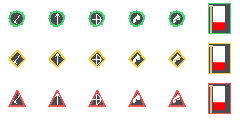

# Війська та знамена на JourneyMap — 1.4.0

Потрібні `townyrecruits-1.4.0.jar` на сервері й усіх клієнтах та **JourneyMap 6.0.7 для Forge 1.20.1** на клієнті. Ця версія JourneyMap уже є у збірці EmpireCraft. Карта необов’язкова: клієнт без неї зберігає решту механік Towny Recruits. Встановлення й пакет оновлення: [TACTICS.md](TACTICS.md).

## Позначки військ

Позначки з’являються автоматично на повноекранній карті й мінімапі у шарі **«Війська та знамена»**.

| Стосунки Towny | Колір | Форма значка бійця |
|---|---|---|
| Своя або союзна нація | Зелений | Коло |
| Нейтральна нація або ненайнятий рекрут | Жовтий | Ромб |
| Ворожа нація | Червоний | Трикутник |

Війна має пріоритет над суперечливим союзом. Після зміни дипломатії колір оновлюється автоматично. Усередині значка показано тип: піхота, пікінер, стрілець, кавалерія або кінний стрілець. Помаранчева позначка означає втечу через мораль. Підказка містить націю, загін, командира й стан бійця.

Це згенерована легенда, а не знімок гри. Рядки зверху вниз: союзники, нейтральні, вороги; стовпчики: піхота, пікінери, стрільці, кавалерія, кінні стрільці та приклад знамена.

Союзники діляться позиціями завантажених рекрутів у поточному вимірі. Нейтральні й ворожі війська показуються, доки сервер надсилає гравцеві їхні сутності через звичайний Minecraft entity tracking; невидимі несоюзні бійці приховані. Це не перевірка прямої видимості через стіни. Вивантажені чанки та інші виміри карта не розкриває й не завантажує.

Дані надходять раз на секунду: до 2 048 бійців і 128 знамен у поточному списку, з пріоритетом союзників і ближчих військ. Позначки прибираються при виході бійця зі списку, зміні виміру чи відключенні. Після п’яти секунд без оновлень список очищується. Позиції на суднах Valkyrien Skies переводяться у світові координати. Збережені waypoints, привати Towny й позначки флоту не змінюються.

## Знамено полку

Кожний полк Towny має окремий значок знамена та назву на великій карті. Спочатку це однотонний прапор зі сталим кольором, визначеним ID полку. Для власного дизайну використовуйте звичайний прапор Minecraft, зокрема візерунки з ткацького верстата:

1. Візьміть прапор в основну руку.
2. Виконайте `/nation regiment banner Перший_полк` — зберегти колір і до 16 шарів візерунків. Зразок не витрачається.
3. Звільніть другу руку обраного рекрута цього полку. Тримаючи такий самий прапор, наведіться на бійця в межах 16 блоків без перешкод і виконайте `/nation regiment bearer Перший_полк`.

Один справжній прапор переходить із вашої руки у другу руку рекрута. Зброя, броня та щит не замінюються: якщо друга рука зайнята іншим предметом, команда відхиляється. Якщо відповідне знамено вже є у рекрута, повторне призначення не витрачає предмета. Боєць, який утікає, не приймає знамено.

Команди доступні керівнику цього полку, королю та уповноваженим офіцерам своєї нації за [правилами полків](ARMY.md). `/nation regiment info Перший_полк` показує колір, кількість візерунків і короткий ID призначеного знаменосця.

На карті знамено слідує за видимим призначеним бійцем, поки він несе прапор відповідного дизайну. Якщо його немає у видимому списку, значок позначає одного з реальних бійців найбільшої місцевої групи полку. Число у підказці — кількість бійців полку, доступних цій карті, а не загальна чисельність у всіх чанках.

`/nation regiment unbearer Перший_полк` скасовує призначення; виданий предмет залишається у рекрута. При заміні знаменосця старий також зберігає свій прапор. Зміна дизайну полку не перемальовує видані предмети: новому знаменосцю потрібен прапор із новим дизайном. Загибель або дезертирство скасовують призначення. Дизайн і ID знаменосця зберігаються після перезапуску; розформування полку видаляє їх із реєстру, зберігаючи спорядження солдатів.

## Перевірка у грі

1. Відкрийте JourneyMap і мінімапу з рекрутами трьох націй: союзної, нейтральної та ворожої. Перевірте кольори, типи, підказки та зміну дипломатії.
2. Відійдіть від нейтральних/ворожих військ за дальність відстеження, вивантажте їхні чанки, змініть вимір і перезайдіть: старі позначки мають зникати. Перевірте спільне відображення завантажених союзників.
3. Зареєструйте прапор із кількома візерунками, призначте знаменосця й перемістіть його. Перевірте збіг дизайну на карті та предметі, збереження кількості прапорів, відмову при зайнятому щитом слоті, повторне призначення й перезапуск.
4. Перевірте смерть, втечу та дезертирство знаменосця, зміну дизайну, інший ресурс-пак і F3+T. Позначки Towny та флоту мають залишатися незалежними.
5. Перевірте позиції війська на рухомому судні та запуск клієнта без JourneyMap. Повний графічний прогін цих сценаріїв у середовищі розробки не проводився; автоматичні перевірки описані у [VALIDATION.md](VALIDATION.md).
